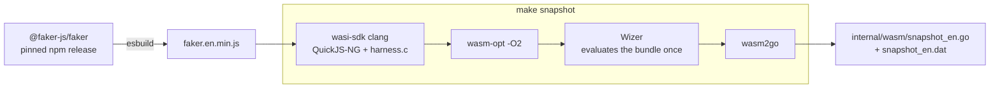
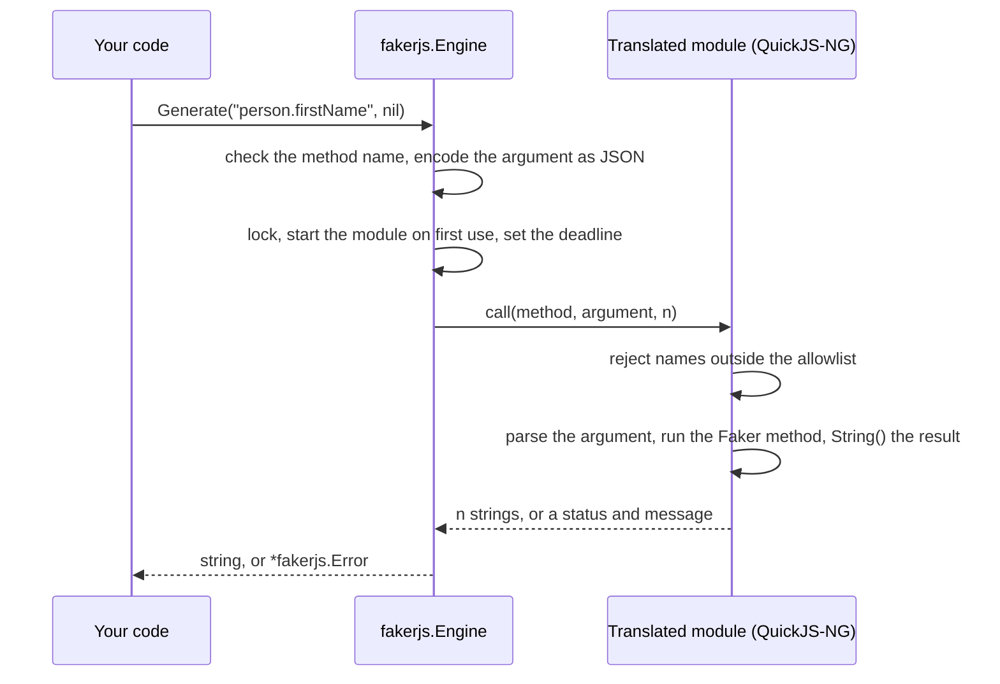

# go-fakerjs

go-fakerjs runs the Faker.js package inside a JavaScript interpreter that is compiled into your Go binary, so you can generate seed-reproducible fake data in Go. It doesn't need cgo, a Wasm runtime, or any third-party dependency, and its output is byte-identical to Faker.js on V8 across the [tested surface](FINDINGS.md#51-conformance).

[](https://github.com/iamramtin/go-fakerjs/actions/workflows/ci.yml)
[](https://pkg.go.dev/github.com/iamramtin/go-fakerjs)
[](LICENSE)

## Why it exists

I wanted seed-reproducible fake data in Go that matches Faker.js exactly, without cgo. Reimplementing Faker in Go wouldn't match its output byte for byte, and embedding V8 needs cgo and a prebuilt library for each platform, so go-fakerjs runs Faker.js itself, translated to Go.

## Install

```sh
go get github.com/iamramtin/go-fakerjs
```

Requires Go 1.27.1 or later (`go.mod`). The generated code is committed, so no build step or toolchain is needed.

## Quickstart

```go
package main

import (
	"fmt"
	"log"
	"time"

	"github.com/iamramtin/go-fakerjs"
)

func main() {
	// A fixed seed and reference date make the output reproducible, including date methods.
	e := fakerjs.NewEngine(42, fakerjs.WithRefDate(time.Date(2026, 1, 1, 0, 0, 0, 0, time.UTC)))
	defer e.Close()

	name, err := e.Generate("person.firstName", nil) // nil calls the method with no argument
	if err != nil {
		log.Fatal(err)
	}

	codes, err := e.GenerateN("string.alpha", map[string]any{"length": 8}, 3) // the argument is JSON-encoded
	if err != nil {
		log.Fatal(err)
	}

	fmt.Println(name, codes)
}
```

- `NewEngine(seed, opts...)` starts lazily on the first call. Seed `0` leaves Faker on its own random seed.
- `GenerateN` returns the same values as `n` calls to `Generate`, in one call into the engine.
- `NewPool(size, seed, opts...)` runs engines in parallel; engine `i` is seeded with `DeriveSeed(seed, i)`.
- `WithTimeout` (default 30 s) and `WithMaxArgBytes` (default 4 MiB) bound each call. Unknown methods fail with
  `ClassUnknownMethod`.

More: [usage examples](example_test.go) and the [package documentation](https://pkg.go.dev/github.com/iamramtin/go-fakerjs).

## Compatibility

| go-fakerjs | Faker.js | Oracle |
|---|---|---|
| v0.1.0 | 10.6.0 (en locale) | Node 22.23.3 (V8 12.4), `TZ=UTC` |

The Faker.js version has one [source of truth](tools.versions), and `make check-versions` fails
if any other statement of it disagrees.

- **Identical output** to Faker.js on V8 for the tested surface when run with `TZ=UTC`: 262 methods, with
  [2,235 of 2,240 per-method cases exact](FINDINGS.md#51-conformance), and all 220 workload cases and all 3
  interleaved sequences exact.
- **Known divergences:** one method, `finance.amount` with `autoFormat`, which needs `Intl`. Every divergence and
  its root cause is listed in the [divergence catalogue](golden/known_divergences.yaml).
- **Time zone:** dates print the UTC zone name. Under any other `TZ`, V8's text differs.
- **Locales:** en only. Locale selection isn't built.

## Performance

The trade-off is throughput. QuickJS interprets Faker's JavaScript, whereas V8 compiles it, so each call is
slower than on V8.

| | v8go | go-fakerjs | wazero + QuickJS |
|---|---|---|---|
| How the JavaScript runs | V8 with its JIT, through cgo | QuickJS-NG bytecode interpreter, compiled to Wasm and translated to Go | QuickJS-NG compiled to Wasm, run by the wazero runtime |
| Engine startup (first value included) | 4.76 ms | 0.299 ms | 22.9 ms |
| Average time per fake value (20-column row, one call per value) | 1.95 µs | 23.9 µs | 75.7 µs |
| Rows/s, 20 fake columns, 1 engine | 25,904 | 2,092 | 661 |
| Rows/s, 20 fake columns, 10 engines | 106,922 | 8,464 | 704 |
| Output identical to Faker.js | V8 itself; not run through the golden suite here | yes on the tested surface, 5 `Intl` divergences | 2,135 of 2,240 per-method cases exact; dates differ |
| cgo / platform limits | cgo; prebuilt V8 for linux and darwin (amd64, arm64) and android | none: pure Go | none: pure Go |

Apple M5, darwin/arm64, [medians of 10 runs](FINDINGS.md#54-performance); v8go builds a script per call. These
figures come from the [development build](results/README.md) that preceded v0.1.0, which has the same pinned
Faker.js and toolchain and the same engine code. Per call, go-fakerjs is 1.3× to 55× slower than v8go depending on
the method, the 20-column row is 12.3× slower, and startup is 15.9× faster. Baseline conformance was measured on a
Linux VM.

**Use it** for tests, fixtures, and tools that need exact, reproducible Faker.js output, a cgo-free build, or many
short-lived engines. **Do not use it** for bulk generation where throughput per core matters; use V8 there.

## How it works

The snapshot is built once per Faker.js release with `make snapshot`, and the generated files are committed:

- **Bundle.** esbuild packs the pinned `@faker-js/faker` and an entry file into one IIFE, targeting ES2020, with
  `_`-prefixed properties mangled.
- **Module.** QuickJS-NG and a C harness are compiled with wasi-sdk to a `wasm32-wasip1` reactor, which `wasm-opt
  -O2` then optimises. Wizer runs the module's initialisation once, evaluating the bundle, and saves the resulting
  memory as a snapshot.
- **Translation.** wasm2go converts the snapshot into Go source, `internal/wasm/snapshot_en.go`, with the data
  segments in `snapshot_en.dat`. The package builds with `CGO_ENABLED=0` and needs no separate Wasm runtime.
- **Engine.** A `fakerjs.Engine` calls into its own copy of the snapshot for each method call, and a
  `fakerjs.Pool` hands out engines for concurrent use.
- **Verification.** Golden outputs come from three oracles: the npm package, the bundle under Node's `vm`, and
  one evaluation per call. Every method and seed must match, unless the difference is listed in the
  [divergence catalogue](golden/known_divergences.yaml) with its root cause.



At run time each call crosses from Go into the translated module once:



The findings explain [why each stage exists](FINDINGS.md#32-why-each-stage-exists).

## Updating Faker.js

Upgrade to the latest minor or patch release, or rehearse an upgrade to a given version without committing
anything:

```sh
make faker-upgrade
make faker-upgrade FAKER=10.5.0
```

The upgrade works in a temporary git worktree. It pins the new version, rebuilds the bundle, the golden data,
and the snapshot, runs the test suites, and requires two clean builds to be byte-identical. It stops at the first
failure. A normal run commits the result on a `faker-upgrade/<version>` branch and pushes nothing, and a dry run
prints the commit message it would use, with the API diff and the conformance counts.

- **Major versions** are refused. Upgrade them by hand.
- **New divergences** from Faker.js fail the tests unless they are listed in the
  [divergence catalogue](golden/known_divergences.yaml) with a reason.
- **No newer version** exits with a message and changes nothing.

The [upgrade guide](CONTRIBUTING.md#fakerjs-upgrades) lists every step and the weekly workflow that runs it.

## Documentation

- [Findings](FINDINGS.md): the method, results, analysis, and replication steps.
- [Contributing](CONTRIBUTING.md): toolchain, regeneration, tests, and
  [Faker.js upgrades](CONTRIBUTING.md#fakerjs-upgrades) (the weekly automation and `make faker-upgrade`).
- [Security](SECURITY.md): threat model and how to report a vulnerability.
- [Changelog](CHANGELOG.md): release notes.
- [Third-party notices](THIRD_PARTY_NOTICES.md): bundled components, tools, and their licences.
- [C harness and Wasm build](wasm/README.md): what the module contains and how it is built.

## AI assistance

Designed and tested with the [help](FINDINGS.md#13-ai-assistance) of Claude Opus 5.5.

## Credits

Faker.js (MIT), QuickJS-NG (MIT; QuickJS by Fabrice Bellard and Charlie Gordon), wasm2go, Wizer, Binaryen,
wasi-sdk, and esbuild. [Versions and licences](THIRD_PARTY_NOTICES.md) are listed in full.

## Licence

Released under the [MIT licence](LICENSE). The generated snapshot also contains code under the licences listed in
[third-party notices](THIRD_PARTY_NOTICES.md).
