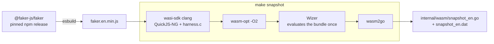
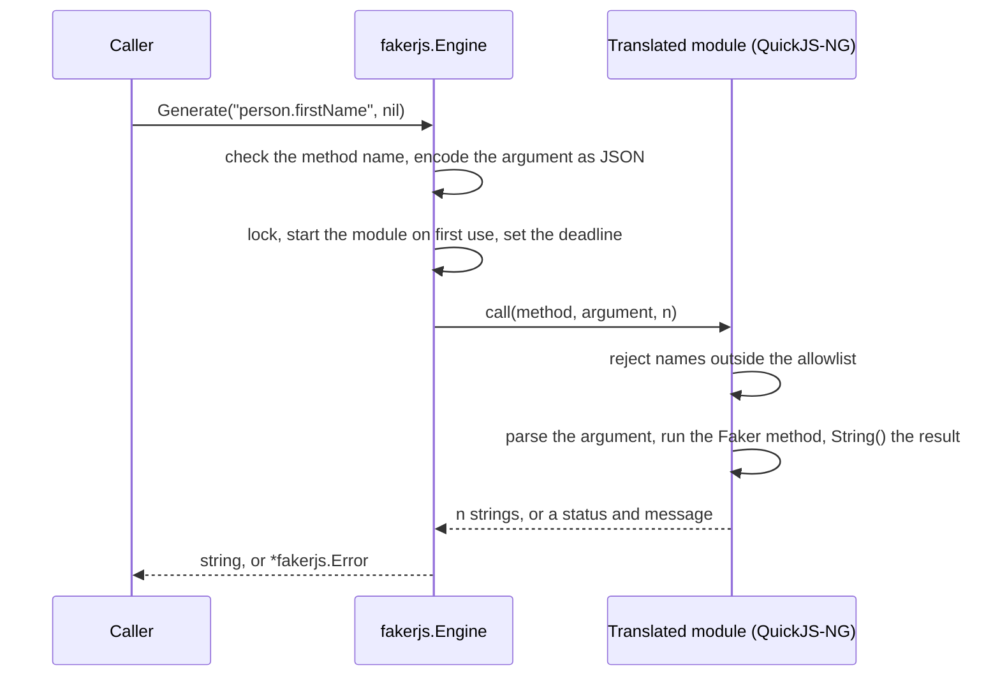

# How it works

go-fakerjs runs the published Faker.js bundle in QuickJS-NG. Both are compiled to one WebAssembly module, pre-initialised with Wizer, and translated to Go source by wasm2go. A `fakerjs.Engine` runs its own copy of that translated module, and a `fakerjs.Pool` hands out engines for concurrent use. The [findings](../FINDINGS.md#32-why-each-stage-exists) explain why each stage exists.

## The build pipeline

The snapshot is built once per Faker.js release with `make snapshot`, and the generated files are committed, so the module builds without the toolchain.

- **Bundle.** esbuild packs the pinned `@faker-js/faker` and an entry file into one IIFE, targeting ES2020, with `_`-prefixed properties mangled.
- **Module.** QuickJS-NG and a C harness are compiled with wasi-sdk to a `wasm32-wasip1` reactor, which `wasm-opt -O2` then optimises. Wizer runs the module's initialisation once, evaluating the bundle, and saves the resulting memory as a snapshot.
- **Translation.** wasm2go converts the snapshot into Go source, `internal/wasm/snapshot_en.go`, with the data segments in `snapshot_en.dat`. The package builds with `CGO_ENABLED=0` and needs no separate Wasm runtime.
- **Verification.** Golden outputs come from three oracles: the npm package, the bundle under Node's `vm`, and one evaluation per call. Every method and seed must match, unless the difference is listed in the [divergence catalogue](../golden/known_divergences.yaml) with its root cause.



The exact tool versions are in [`tools.versions`](../tools.versions) and the [pipeline table](../FINDINGS.md#31-pipeline-and-exact-versions). `make snapshot-repro` builds the snapshot twice, the second time from another absolute path, and requires byte-identical output ([reproducibility](../FINDINGS.md#53-build-and-reproducibility)).

## A call

Each call crosses from Go into the translated module once:



- **Start-up.** `NewEngine` does no work. The first call instantiates the snapshot, mixes 32 bytes from `crypto/rand` into `Math.random`, seeds Faker.js, and applies the reference date, in that order.
- **Method names.** The Go side checks the grammar `^[a-zA-Z][a-zA-Z0-9]*\.[a-zA-Z][a-zA-Z0-9]*$` and a length of at most 256 bytes, and the module checks it again. The module then rejects any name outside the 262 it listed at initialisation ([method allowlist](../FINDINGS.md#35-method-allowlist)).
- **Arguments.** A `nil` argument calls the method bare. Anything else is marshalled with `encoding/json` and parsed by the module with `JS_ParseJSON`. An object argument is parsed again for each of the `n` results, so `GenerateN` behaves like `n` separate calls even when a method mutates its argument.
- **Results.** Each result is converted with JavaScript's `String()` and returned as a Go `string`. Invalid UTF-8 is replaced with U+FFFD.
- **Limits.** The module's JavaScript heap is limited to 160 MiB, its WebAssembly memory to 256 MiB, and a call's results to 64 MiB. A call that grows the WebAssembly memory keeps that memory until the engine is closed ([robustness](../FINDINGS.md#52-robustness)).
- **Poisoning.** A trap, a panic in a host import, or a corrupt result buffer marks the engine as poisoned. Every later call fails with `ErrPoisoned`, and `Engine.Poisoned` reports it.

The [C harness](../wasm/README.md) lists the module's exports, imports, and memory settings.

## Adopting a Faker.js release

Upgrade to the latest minor or patch release, or rehearse an upgrade to a given version without committing anything:

```sh
make faker-upgrade
make faker-upgrade FAKER=10.5.0
```

The upgrade works in a temporary git worktree. It pins the new version, rebuilds the bundle, the golden data, and the snapshot, runs the test suites, and requires two clean builds to be byte-identical. It stops at the first failure. A normal run commits the result on a `faker-upgrade/<version>` branch and pushes nothing, and a dry run prints the commit message it would use, with the API diff and the conformance counts.

- **Major versions** are refused and are upgraded by hand.
- **New divergences** from Faker.js fail the tests unless they are listed in the [divergence catalogue](../golden/known_divergences.yaml) with a reason.
- **No newer version** exits with a message and changes nothing.

The [upgrade guide](../CONTRIBUTING.md#fakerjs-upgrades) lists every step and the weekly workflow that runs it.
